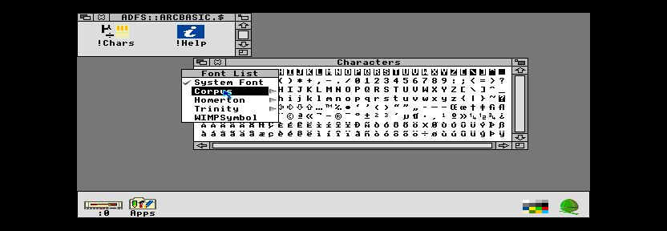
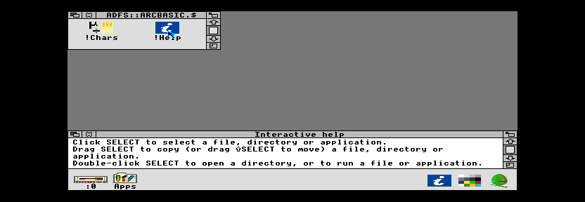

# Original Squash, Chars, Help and Alarm

The restored utilities pass their live gates on ROM
`e905575c4e064b9153138076ab05681067f760a2efbedbcc0c126662259ccce1`.
The combined image uses **2,076,436 bytes**, leaving **20,716 bytes** in 2 MiB.
Draw, Paint and Edit remain in ROM. The kernel and emulator are unchanged.

This is the original cleaned-3.60 Squash 0.24, Chars 1.18 and Help 2.28 cohort,
with the source/build corrections in [RESTORATION.md](RESTORATION.md). Neither
BASIC application is a replacement implementation. Their programs are
compacted for ROM by the ArcLibre squish tool (below); the leading licence REM
lines are preserved byte for byte.
Help uses its original flat 2D template. See [licensing](../../LICENSING.md).

## Dedicated verification

Each suite runs on the final ROM, starting from a real ARM2 cold reset:

| Gate | Evidence |
|---|---|
| Squash | Three identical cold runs; fast/restartable compression, both decoders, independent host gzip decoding of eight non-empty streams, 31,744/17,408-byte workspace size contracts and canaries. |
| Stream boundaries | Empty input follows the original state implementation; two- and four-byte initial output buffers resume without losing the input or overwriting their capacity. |
| Independent workspaces | Alternate two real decompression streams with different input/output chunk sizes; compare both complete outputs. |
| Errors | Real translated bad-parameter, bad-address, corrupt-input, corrupt-workspace and unknown-SWI errors; real MessageTrans file handle. |
| Missing module | The same client fails on its first `Squash_Compress` query with `SWI &42700 not known` when Squash is absent. |
| Chars | Three identical cold launches through Filer; Select emits A and Shift emits B via `Wimp_ProcessKey`; original font menu selects and paints WIMPSymbol; close box removes the task. |
| Help | Three identical cold launches through Filer; real &502 HelpRequest/&503 HelpReply exchange with Filer and visible help text; icon-bar Quit removes the task; relaunch succeeds without a stale Help$Dir. |
| Instruction paths | Independent final-ROM byte/decode checks and classification of all observed software-FPA traps; no prefetch/data aborts or address exceptions. |

Squash is **7,204 bytes** with **1,632 independently decoded ARM2 integer
instructions**, **66 resolved relocations**, no unresolved symbols and no FPA
instructions. Its actual private RMA image is **100 bytes**; the register bias
for GCC's static-data ABI does not create extra fixed workspace. Chars and Help
registration modules, including their BASIC program resources, are 9,064 and
16,724 bytes respectively. Two normal and one observer assembly are identical.

The protocol reports are produced as `build/squash-tests/acceptance.json` and
`build/basic-utility-tests/acceptance.json`, with captures and sampled traces
beside them. Release recording copies them to
`docs/archimedes-desktop/reports/squash-acceptance.json` and
`docs/archimedes-desktop/reports/basic-utilities-acceptance.json` only after
all required final-ROM release gates pass.

## Reproducibility correction

A rebuild across midnight exposed the C library's `__DATE__` identification:
the earlier image contained `Oct 26 2026`, while the same sources rebuilt as
`Oct 27 2026`. Its fixed identification now reads `[ArcLibre]`. This changes
no library interface and saves four bytes. The source patch is
`patches/desktop-c/0002-reproducible-library-identification.patch`.

`tests/check_library_identity.py` compiles the actual source with simulated
1970 and 2099 dates; both generated assemblies must exactly match the normal
build. Two complete C/application builds reproduce the same ROM. Packaging also
rebuilds the exact shipped source archive, with its bundled host tools, in a
new directory and requires byte identity before publishing the evidence bundle.

## Alarm and BASIC compaction

The original Alarm application (`Apps/Alarm` @ `ea4dc989e312`, 20 pinned files)
is shipped on its own floppy, `arclibre-alarm.adf`, by owner decision
(28 Oct 2026): RISC OS 3.11 had it in ROM, but moving it out (83,796 bytes
with its resources) makes room for the original networking modules.
`tools/build_alarm_disc.py` lays out the original Makefile's disc install
(`!Boot`, `!Help`, the disc `!Run`, `!RunImage`, `Alarms`, `Code`, `Messages`
and the flat `Templates`) plus a ReadMe (`src/ArcLibre/alarm/ReadMe`). The
disc `!Run` and the empty `Alarms` file are pinned from the same revision.
!Configure's Application auto-start window shades !Alarm when it is not in
`Resources:`, and its All button leaves Alarm's bit clear.

Alarm's `Code` (1,572 bytes) is generated by running the
original `bas/AlarmSrc` assembler at the real F12 command line of the ROM built
without the BASIC utilities (`tools/generate_alarm_code.py`, `BasicRunProbe`);
two independent runs must match. The wrapper patch is
`patches/desktop-utilities/0007-alarm-application-build.patch`.

`tools/basic_squish.py` compacts tokenised BASIC in three stages: an exact model
of BASIC V's own `CRUNCH` (identical length and hash to BASIC 1.14 for four
emulator-measured cases), frequency renaming of variables, arrays, `PROC` and
`FN` names (resident `A%`–`Z%` and `@%` excepted), and line merging where line
structure allows. It refuses `EVAL`, `CHAIN`, `LIBRARY`, `INSTALL`, `OVERLAY`
and assembler. `tests/check_basic_squish.py` independently compares statement
streams after reversing the renaming; it detects name swaps and 200/200 random
byte corruptions.

The first Alarm build failed with "Unknown or missing variable". Bisection on
the emulator traced it to line 22250, `DRAW BY ...`: BASIC reads `BY` after
`DRAW`, `MOVE`, `FILL` and `POINT` as plain letters (`src/BASIC/Stmt2`
`PLOTER1`), and both the renamer and the checker had treated it as a variable.
Both now handle it separately, and the checker rejects any rename of such a
context word; a deliberately reintroduced defect is detected. A search of the
interpreter for other literal-letter syntax found only `TOP`, already handled.

| Program | Original | Squished |
|---|---|---|
| Alarm `!RunImage` | 144,844 | 61,338 |
| Help `!RunImage` | 16,477 | 8,772 |
| Chars `!RunImage` | 8,868 | 5,034 |

The gate launches each application three times from cold boots; Alarm is
double-clicked in the Alarm disc's directory viewer. From a floppy it reads
its files before creating its clock, so the probe waits (bounded) for that
icon. Alarm Quits from its icon-bar menu and restarts; its Set alarm window then sets an alarm two
minutes ahead with a typed message. The alarm is not delivered early, arrives in
its minute with the message and real sound DMA, and the browser's redraw
executes SWIs from the exact generated `Code`. The negative control runs the
old ROM launcher (`Run Resources:$.Apps.!Alarm.!Run`) on the delivered ROM,
which must fail with "not found". Saving the alarm list is not tested: Alarm
saves through `Choices:`, which this boot-less configuration does not define.

Messages files also lose their `#` comment lines at ROM assembly (5,316 bytes;
MessageTrans ignores them, and none carries a notice).

## Limits and next work

These are bounded functional tests, not exhaustive Squash input validation,
every font/character encoding, every Help client or full RISC OS 3.11
compatibility. Chars key generation is observed at its public Wimp interface.
The user has manually confirmed Chars works as expected; this is not a
retained automated insertion gate. No proprietary
ROM or game resources are included.

The next practical utility milestone is RTCAdjust and the original Alarm
application, with explicit clock/CMOS and desktop lifecycle tests. DOSFS still
needs the separate boot-sector provenance and build-tool review. Original-machine
Configure, printing, device coverage and physical ARM2/ARM3 validation remain
on the wider roadmap.
