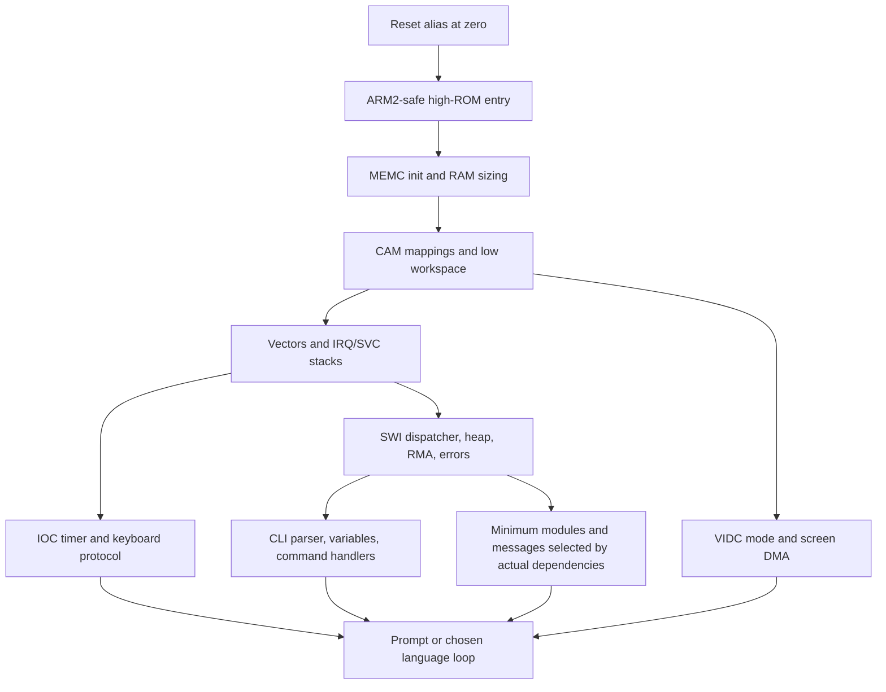
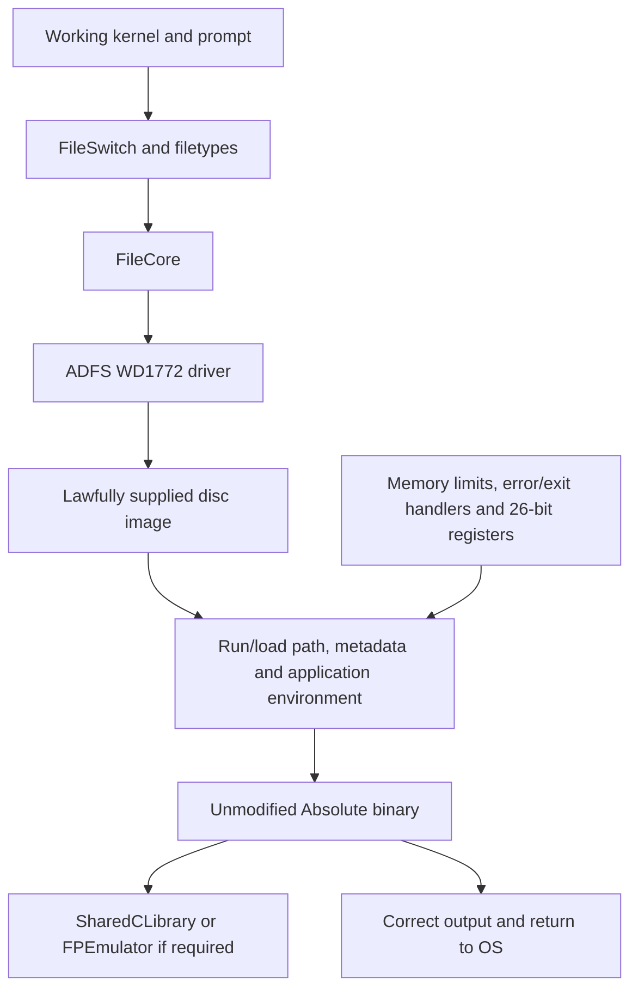
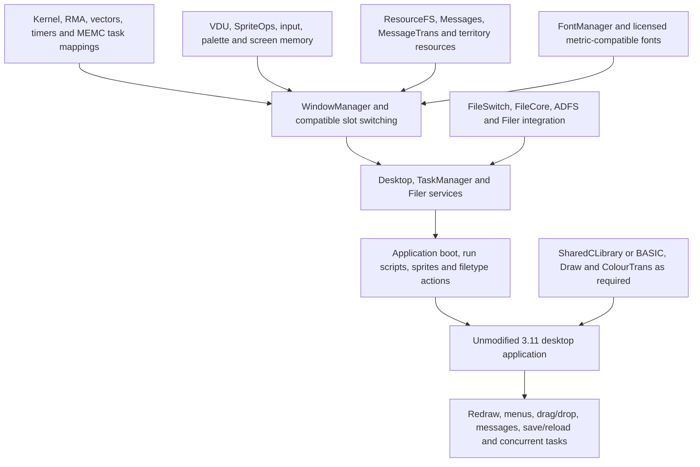

# Reset, software loading and ROM packaging

25 October 2026. This is a source trace and proposed dependency model, **not an observed boot log**. Source identifiers resolve through [the evidence register](SOURCE_AND_LICENSES.md#code-evidence).

## What actually happens in the selected RO26 sources

`Env/Ursula` selects Morris/4096K/APCS-R. Kernel `s/GetAll` imports those headers, selects ARM600 memory support and VIDC20 palette handling, and includes `s/Kernel`, reset, module handling and VDU sources. `IncludeTestSrc` is true for Morris, so the initial ROM content includes `TestSrc/Begin`; treating the simple alternative `B CONT` vector as the selected reset path would be incorrect. [B1](SOURCE_AND_LICENSES.md#b1) [K1](SOURCE_AND_LICENSES.md#k1) [K2](SOURCE_AND_LICENSES.md#k2) [K9](SOURCE_AND_LICENSES.md#k9) [K10](SOURCE_AND_LICENSES.md#k10)

The ROM is logically assembled at `0x03800000`. The current kernel also defines an IOMD physical ROM base of zero. POST’s `MODE` macro uses 32-bit status-register/mode operations. `CONT` calls `InitMEMC`, initialises video, masks interrupts and starts the timer; it uses IOMD-specific registers and later enters IRQ32 for stack/vector setup. That is not an ARM2/ARM3 startup sequence just because applications ultimately run in 26-bit mode. [K8](SOURCE_AND_LICENSES.md#k8) [K11](SOURCE_AND_LICENSES.md#k11) [K6](SOURCE_AND_LICENSES.md#k6)

The **pre-conversion kernel** at `24044755f08dc3b99779833a57eecf3899561ce6` is materially different: its non-ARM600 path empties CAM entries and maps fixed cursor/system/workspace areas, has ARM3 detection/cache support, and sets IRQ/SVC modes with `TEQP`. Its POST `MODE` macro also uses the old status model. These are the preferred startup candidates; include closure and emitted instructions have not been tested. [P1](SOURCE_AND_LICENSES.md#p1) [P2](SOURCE_AND_LICENSES.md#p2)

On the target emulator, reset sets PC to zero and MEMC overlays ROM. The first high-region access removes the overlay. A correct original-machine reset branch must therefore survive alias execution at zero and then reach its linked high-ROM address before installing low-RAM vectors. Early code cannot assume a usable stack until mappings and banked stack pointers are set. The old workspace names RMA, heap and cursor regions at `0x01800000`, `0x01C00000` and `0x01F00000`; these are source constants, not a verified 3.11 compatibility contract. [M13](SOURCE_AND_LICENSES.md#m13) [M6](SOURCE_AND_LICENSES.md#m6) [P1](SOURCE_AND_LICENSES.md#p1) [K12](SOURCE_AND_LICENSES.md#k12)

Later initialisation in the current source calls VDU, execution environment, keyboard, mouse and CLI setup before variables and `ModuleInit`, then issues `Service_PostInit`. Module handling scans ROM chains, considers module versions/unplug state, and initialises the selected implementations. The product file explicitly places Desktop at the language index expected by its configuration. Mixing a different module order with old CMOS defaults can select the wrong language. Reconstruct and test the order for the candidate rather than transplanting the later list unchanged. [K7](SOURCE_AND_LICENSES.md#k7) [K13](SOURCE_AND_LICENSES.md#k13) [B2](SOURCE_AND_LICENSES.md#b2)

## Smallest credible path to a prompt

The graph describes required capabilities; it is not a proven minimal component list. The kernel CLI parser exists separately from the desktop ShellCLI module. A prompt also needs a command loop/default language decision, error handling and working input, not just `OS_WriteC`.

Relevant source: [K3](SOURCE_AND_LICENSES.md#k3) [K4](SOURCE_AND_LICENSES.md#k4) [P1](SOURCE_AND_LICENSES.md#p1) [K15](SOURCE_AND_LICENSES.md#k15) [K17](SOURCE_AND_LICENSES.md#k17) [K7](SOURCE_AND_LICENSES.md#k7). Removing desktop modules is legitimate for this milestone only; it does not define the final product.

## Path to an existing Absolute binary

ResourceFS can help provide original test resources without floppy I/O, but cannot substitute for validating disc-based software loading. Absolute is filetype `&FF8`; some files use AIF headers while small absolute code may have other valid loader conventions. Test each selected format and load/exec metadata rather than assuming every executable is one layout. [Code formats](https://www.riscos.com/support/developers/prm/objectformat.html), [FileSwitch](https://www.riscos.com/support/developers/prm/fileswitch.html), [A1](SOURCE_AND_LICENSES.md#a1) [K14](SOURCE_AND_LICENSES.md#k14).

## Path to a typical 3.11 desktop application

This is why a booting ROM can still fail every useful application test. WIMP memory services, resources and fonts are first-class requirements. Toolbox, DrawFile, ColourPicker and DragAnObject from later products must not be made mandatory parts of an unextended 3.11 baseline merely because they occur in RO26’s product list. [W1](SOURCE_AND_LICENSES.md#w1) [W2](SOURCE_AND_LICENSES.md#w2) [B2](SOURCE_AND_LICENSES.md#b2) [PRM index separating base chapters and later supplement](https://www.riscos.com/support/developers/prm/index.html).

## ROM capacity and packaging

| Item | Evidence and consequence |
|---|---|
| Original 3.1 image | 2 MiB baseline; MacArch recogniser implements that size, and vendor history describes four ROMs versus two on later integrated machines. This audit did not inspect an original ROM binary. [M3](SOURCE_AND_LICENSES.md#m3) [Platform history](https://riscos.com/riscos/310/index.php). |
| RO26 image | `ImageSize 4096K` in the actual environment. This is a configured capacity and an author-reported release size, **not a measured sum of live component bytes**. [B1](SOURCE_AND_LICENSES.md#b1) [RO26 build page](https://www.marutan.net/ro26/). |
| MEMC address capacity | The VLSI MEMC data sheet specifies high ROM at `0x03800000–0x03FFFFFF` (8 MiB) and low ROM at `0x03400000–0x037FFFFF` (4 MiB). This does not establish populated socket capacity, decoded address lines or safe replacement devices. [1990 VLSI ARM Family manual, VL86C110, printed p. 4-9](https://archive.decromancer.ca/bitsavers.org/components/vti/1990_Acorn_RISC_Machine_Family_Data_Manual.pdf). |
| MacArch variable sizes | Core `ROMImage.build` requires >=1 KiB and an accepted initial branch/load-PC pattern. MEMC rounds storage to a power of two and masks addresses; a 4 MiB input is not rejected here. Library import instead requires recognised sizes/version text. Use the explicit core/headless path for future custom images. No image was loaded in this audit. [M2](SOURCE_AND_LICENSES.md#m2) [M3](SOURCE_AND_LICENSES.md#m3) [M4](SOURCE_AND_LICENSES.md#m4) [M5](SOURCE_AND_LICENSES.md#m5) [M11](SOURCE_AND_LICENSES.md#m11) |
| Chip interleaving | Core supports concatenation, four equal byte-wide chips or two equal 16-bit halves. A logical little-endian image must be transformed to the board’s actual chip wiring, which is not established by the importer’s heuristic. [M2](SOURCE_AND_LICENSES.md#m2) |
| ROM module framing | Pinned romlinker writes module link lengths, drops the kernel’s trailing word for joining, patches image size at `0x60`, terminates the chain and pads a footer. MacArch’s loader does not validate these OS structures/checksums. [B5](SOURCE_AND_LICENSES.md#b5) [M2](SOURCE_AND_LICENSES.md#m2) |
| Checksum caution | RO26 pins romlinker **0.03**. Its footer code includes `crc_64[i & 3]` with a source comment questioning correctness. Current ROOL documentation discusses newer footer and compression formats. Resolve the actual kernel/POST checks before reusing a modern format; neither source inspection nor a successful import proves a valid boot image. [B5](SOURCE_AND_LICENSES.md#b5) [B6](SOURCE_AND_LICENSES.md#b6) [Current format documentation](https://www.riscosopen.org/wiki/documentation/show/ROM%20image%20format). |

A 4 MiB ROM cannot simply be installed in a 2 MiB physical set. Equally, the evidence does **not** justify calling the project impossible solely because RO26 selects 4 MiB. Viable hypotheses are: trim optional later components while retaining the 3.11 stack; use an independently redistributable boot ROM plus disc-loaded optional modules with explicit RAM/startup trade-offs; or investigate a larger, electrically suitable physical carrier. Compression requires a verified decompressor and RAM budget. Bank switching is not assumed. Loading a 4 MiB OS into a 4 MiB RAM machine would leave inadequate application space; do not treat softloading as a free capacity fix.

No linked size map exists for the proposed product, so there is no defensible byte budget yet. Require per-module code, resource, alignment and workspace measurements, including the minimum WIMP corpus’s free RAM, before claiming a 2 MiB complete replacement. Real-hardware work additionally needs board schematics, chip widths, pinouts, access times, voltage and address decoding reviewed separately. Emulator compatibility can plausibly precede this, while final hardware compatibility remains required.
